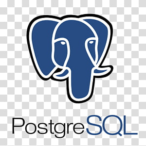
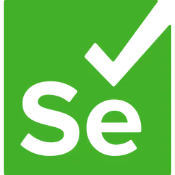

<h1 align="center">Hi, I'm Sampath  </h1>
<h3 align="center">Software Engineer from Visakhapatnam.</h3>

 

  <h3>Profile Views :-</h3>
  

 

- I have 3+ years of experience working in areas mainly focused on backend development, database internals development and CI/CD development.

- I’m very enthusiastic about web scraping and extracting some valuable insights from the data I scraped.

- I'm interested in exploring new opportunities in backend development, web crawling and database development.

 

### Connect with me:

  
  

 

### Languages and Tools:

  
  
  
  
  
  

